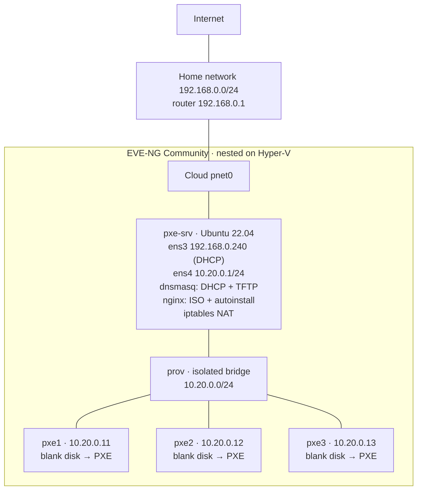
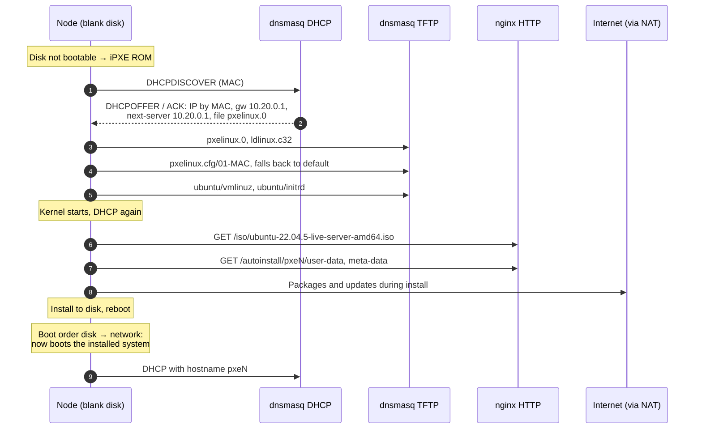

# PXE Network Install Lab: Ubuntu Autoinstall with dnsmasq (EVE-NG)

Unattended network installation of Ubuntu Server 22.04 on blank machines over PXE. A single Ubuntu server provides DHCP, TFTP and HTTP on an isolated provisioning network; nodes with empty disks boot from the network, install themselves with autoinstall (cloud-init) and come up with a name and address assigned by their MAC.

This is a home lab for practice, built in EVE-NG nested on Hyper-V. Times below come from the dnsmasq log.

## Environment

| Component             | Details                                                                 |
| --------------------- | ----------------------------------------------------------------------- |
| Host                  | Windows 11 Pro, Hyper-V, i7-12700K, 32 GB RAM                           |
| Lab platform          | EVE-NG Community (nested KVM)                                           |
| PXE server `pxe-srv`  | Ubuntu 22.04.5, 2 vCPU, 2 GB RAM, two NICs                              |
| PXE server software   | dnsmasq 2.91 (DHCP + TFTP), nginx (HTTP), PXELINUX 6.04, iptables NAT   |
| Clients `pxe1`–`pxe3` | 2 vCPU, 4 GB RAM, blank 20 GB disk, virtio NIC with iPXE ROM, BIOS boot |
| Installed OS          | Ubuntu Server 22.04.5 LTS (live-server ISO, autoinstall)                |

| Host         | Interface           | Address                               |
| ------------ | ------------------- | ------------------------------------- |
| pxe-srv      | ens3 → home network | 192.168.0.240 (DHCP from home router) |
| pxe-srv      | ens4 → provisioning | 10.20.0.1/24 (static, no gateway)     |
| pxe1         | 00:50:00:00:02:00   | 10.20.0.11 (reserved)                 |
| pxe2         | 00:50:00:00:03:00   | 10.20.0.12 (reserved)                 |
| pxe3         | 00:50:00:00:04:00   | 10.20.0.13 (reserved)                 |
| dynamic pool |                     | 10.20.0.100–10.20.0.150               |

## Topology



The provisioning network is isolated on purpose: the home router already runs DHCP, and a second DHCP server on the same segment would conflict with it. This mirrors a data center, where machines are installed on a dedicated provisioning network.

## How a node installs itself



## Build

### 1. EVE-NG nodes

- Blank image for the clients (the node must have an empty disk, otherwise it boots the existing OS and never reaches PXE):
  ```bash
  mkdir -p /opt/unetlab/addons/qemu/linux-pxe-blank
  qemu-img create -f qcow2 /opt/unetlab/addons/qemu/linux-pxe-blank/virtioa.qcow2 20G
  /opt/unetlab/wrappers/unl_wrapper -a fixpermissions
  ```
- Client QEMU options: replace `-boot order=cd` with `-boot order=cn` (disk first, then network). A blank disk falls through to PXE; after installation the node boots from disk and does not reinstall in a loop.
  ```
  -machine type=pc,accel=kvm -vga std -usbdevice tablet -boot order=cn -cpu host
  ```
- `pxe-srv`: two NICs, `e0` to Cloud `pnet0`, `e1` to the isolated bridge `prov`. Clients connect only to `prov`.

### 2. pxe-srv network and NAT

`ens4` was set to `10.20.0.1/24` in the Ubuntu installer with no gateway, so the default route stays on `ens3`.

```bash
echo 'net.ipv4.ip_forward=1' | sudo tee /etc/sysctl.d/99-forward.conf
sudo sysctl --system
sudo iptables -t nat -A POSTROUTING -s 10.20.0.0/24 -o ens3 -j MASQUERADE
sudo DEBIAN_FRONTEND=noninteractive apt-get install -y iptables-persistent
sudo netfilter-persistent save
sudo apt-get install -y dnsmasq nginx pxelinux syslinux-common
```

### 3. DHCP and TFTP (dnsmasq)

`/etc/dnsmasq.d/pxe.conf`:

```ini
port=0
interface=ens4
bind-interfaces
dhcp-range=10.20.0.100,10.20.0.150,12h
dhcp-option=option:router,10.20.0.1
dhcp-option=option:dns-server,8.8.8.8,1.1.1.1
enable-tftp
tftp-root=/srv/tftp
dhcp-boot=pxelinux.0
log-dhcp
```

| Line                                     | Purpose                                     |
| ---------------------------------------- | ------------------------------------------- |
| `port=0`                                 | DNS off; only DHCP and TFTP are needed      |
| `interface=ens4`, `bind-interfaces`      | Serve the provisioning network only         |
| `dhcp-range=10.20.0.100,10.20.0.150,12h` | Enables DHCP with a pool and 12 h lease     |
| `dhcp-option=option:router,10.20.0.1`    | Option 3, gateway (pxe-srv NAT)             |
| `dhcp-option=option:dns-server,...`      | Option 6, public DNS for the installer      |
| `enable-tftp`, `tftp-root=/srv/tftp`     | Built-in TFTP server and its root           |
| `dhcp-boot=pxelinux.0`                   | Option 67 boot file; next-server is pxe-srv |
| `log-dhcp`                               | Full DHCP exchange in the journal           |

`/etc/dnsmasq.d/hosts.conf` reserves an address and name for each MAC:

```ini
dhcp-host=00:50:00:00:02:00,10.20.0.11,pxe1
dhcp-host=00:50:00:00:03:00,10.20.0.12,pxe2
dhcp-host=00:50:00:00:04:00,10.20.0.13,pxe3
```

### 4. Boot loader, kernel and ISO

```bash
sudo mkdir -p /srv/tftp/pxelinux.cfg /srv/tftp/ubuntu /var/www/html/iso
sudo cp /usr/lib/PXELINUX/pxelinux.0 /usr/lib/syslinux/modules/bios/ldlinux.c32 /srv/tftp/
cd /var/www/html/iso
sudo wget https://releases.ubuntu.com/22.04/ubuntu-22.04.5-live-server-amd64.iso
sudo mount -o loop,ro ubuntu-22.04.5-live-server-amd64.iso /mnt
sudo cp /mnt/casper/vmlinuz /mnt/casper/initrd /srv/tftp/ubuntu/
sudo umount /mnt
```

`/srv/tftp/pxelinux.cfg/default` boots the installer:

```text
DEFAULT install
PROMPT 0
TIMEOUT 50
LABEL install
  KERNEL ubuntu/vmlinuz
  INITRD ubuntu/initrd
  APPEND root=/dev/ram0 ramdisk_size=1500000 ip=dhcp url=http://10.20.0.1/iso/ubuntu-22.04.5-live-server-amd64.iso autoinstall ds=nocloud-net;s=http://10.20.0.1/autoinstall/ cloud-config-url=/dev/null
```

- `url=` — the installer downloads the ISO over HTTP into RAM (this is why clients need 4 GB)
- `autoinstall ds=nocloud-net;s=...` — unattended install with the cloud-init data from that URL
- `cloud-config-url=/dev/null` — stops cloud-init from downloading the ISO a second time

### 5. Per-node configuration by MAC

PXELINUX looks for its config in this order: machine UUID, `01-<MAC>`, IP address in hex (shortening it one digit at a time), then `default`. The dnsmasq log shows the full search, for example for `10.20.0.150`:

```text
file /srv/tftp/pxelinux.cfg/01-00-50-00-00-02-00 not found
file /srv/tftp/pxelinux.cfg/0A140096 not found
...
sent /srv/tftp/pxelinux.cfg/default
```

`user-data` template (the password is a SHA-512 hash from `openssl passwd -6`; `meta-data` must exist even if empty):

```yaml
#cloud-config
autoinstall:
  version: 1
  identity:
    hostname: pxe2
    username: admin1
    password: "<hash>"
  ssh:
    install-server: true
    allow-pw: true
  storage:
    layout:
      name: direct
```

Each node gets a `01-<MAC>` file that points to its own autoinstall directory, and each directory has a `user-data` with its hostname:

```bash
for n in 1 2 3; do
  mac="00-50-00-00-0$((n+1))-00"
  sudo mkdir -p /var/www/html/autoinstall/pxe$n
  sudo sed "s/hostname: pxe-node/hostname: pxe$n/" /var/www/html/autoinstall/user-data \
    | sudo tee /var/www/html/autoinstall/pxe$n/user-data >/dev/null
  sudo touch /var/www/html/autoinstall/pxe$n/{meta-data,vendor-data}
  sudo sed "s#s=http://10.20.0.1/autoinstall/#s=http://10.20.0.1/autoinstall/pxe$n/#" \
    /srv/tftp/pxelinux.cfg/default | sudo tee /srv/tftp/pxelinux.cfg/01-$mac >/dev/null
done
sudo systemctl restart dnsmasq
```

## Results

### First node (shared `default` config)

| UTC      | Event                                                                         |
| -------- | ----------------------------------------------------------------------------- |
| 03:24:05 | iPXE DHCP: `10.20.0.150`, next-server `10.20.0.1`, file `pxelinux.0`          |
| 03:24:05 | TFTP: `pxelinux.0`, `ldlinux.c32`, config search, `pxelinux.cfg/default`      |
| 03:24:07 | TFTP: `vmlinuz`                                                               |
| 03:24:27 | TFTP: `initrd` (about 20 s)                                                   |
| 03:24:44 | Installer (`ubuntu-server`) requests DHCP, downloads ISO and autoinstall data |
| 03:33:10 | Installed system boots from disk and requests DHCP as `pxe-node`              |

**Blank disk to installed OS: about 9 minutes.**

### Two nodes in parallel (per-MAC configs)

```text
sent /srv/tftp/pxelinux.cfg/01-00-50-00-00-03-00 to 10.20.0.12
file /srv/tftp/pxelinux.cfg/d8dd24f1-c7a2-334c-8619-7ecdb9bd229e not found for 10.20.0.13
sent /srv/tftp/pxelinux.cfg/01-00-50-00-00-04-00 to 10.20.0.13
```

Both nodes got their reserved address, loaded their own config and installed at the same time. Verified from `pxe-srv`:

```text
$ for ip in 10.20.0.12 10.20.0.13; do ssh admin1@$ip "hostname; ip -4 -br a | grep ens"; done
pxe2
ens3   UP   10.20.0.12/24 metric 100
pxe3
ens3   UP   10.20.0.13/24 metric 100
```

`pxe1` was installed only in the first run (with the shared config, hostname `pxe-node`) and was not reinstalled with its per-MAC config.

## Monitoring an install from pxe-srv

| Stage                        | Where to see it                                              |
| ---------------------------- | ------------------------------------------------------------ |
| DHCP and boot files          | `journalctl -u dnsmasq -f` (`DHCPACK`, `sent /srv/tftp/...`) |
| ISO and autoinstall download | `/var/log/nginx/access.log`                                  |
| Current leases and names     | `/var/lib/misc/dnsmasq.leases`                               |
| Installation still running   | traffic counters on `ens4`: `ip -s link show ens4`           |
| Installation finished        | SSH port 22 open on the node                                 |

The hostname appearing in DHCP is not a sign that the install has finished: cloud-init in the live installer already uses it. An open SSH port on the installed system is the reliable indicator.

## Problems and fixes

| #   | Symptom                                                                                                                   | Cause                                                                   | Fix                                                                              |
| --- | ------------------------------------------------------------------------------------------------------------------------- | ----------------------------------------------------------------------- | -------------------------------------------------------------------------------- |
| 1   | Clients created from the existing Ubuntu image would boot that OS, not PXE; EVE-NG does not allow a node without an image | Every node needs an image                                               | Created a separate image with an empty 20 GB disk (`linux-pxe-blank`)            |
| 2   | Clients would boot only from disk or CD                                                                                   | Default QEMU option `-boot order=cd`                                    | Replaced with `-boot order=cn` (one `-boot` option only)                         |
| 3   | `dnsmasq` failed to start: `failed to create listening socket for port 53: Address already in use`                        | `systemd-resolved` uses port 53; dnsmasq starts a DNS server by default | `port=0` in the config: DNS off, DHCP and TFTP only                              |
| 4   | `pxelinux.0` and `ldlinux.c32` missing                                                                                    | Package install had not completed                                       | Ran `apt-get install pxelinux syslinux-common` again and checked the files       |
| 5   | NAT rule listed twice                                                                                                     | Command run twice                                                       | Deleted one rule with `iptables -t nat -D ...`, then `netfilter-persistent save` |
| 6   | `GET /autoinstall/pxe3/vendor-data` returns 404                                                                           | `vendor-data` is optional in the NoCloud data source                    | Harmless; creating an empty file removes the 404                                 |

## Design notes

- **Isolated provisioning network.** DHCP for installation must not reach the production or home network. `interface=ens4` and `bind-interfaces` keep dnsmasq on that network only.
- **Boot order disk → network** avoids an install loop without needing a boot menu.
- **Identity by MAC.** The same MAC gets the same address (`dhcp-host`) and the same install config (`pxelinux.cfg/01-<MAC>`), which is how bare-metal provisioning tools identify machines.
- **RAM.** The Ubuntu live-server netboot loads the whole ISO (about 2 GB) into memory, so clients need 4 GB.
